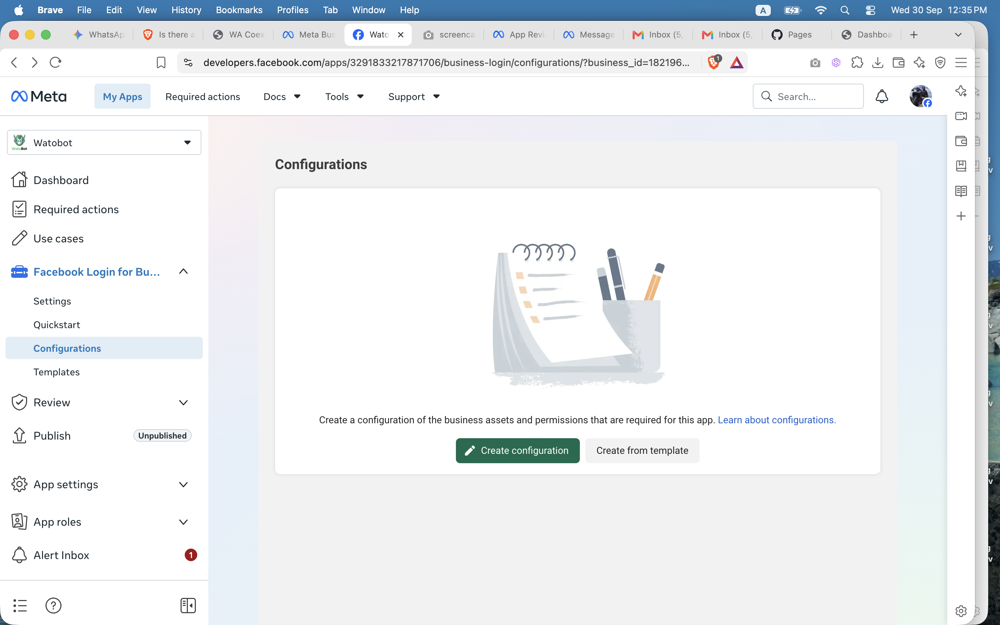
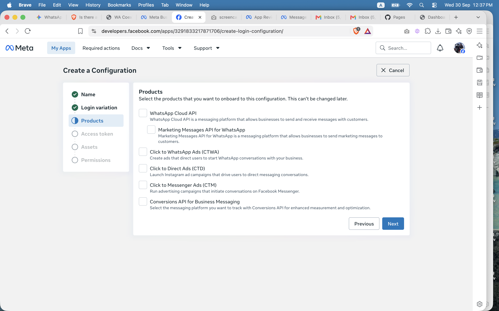
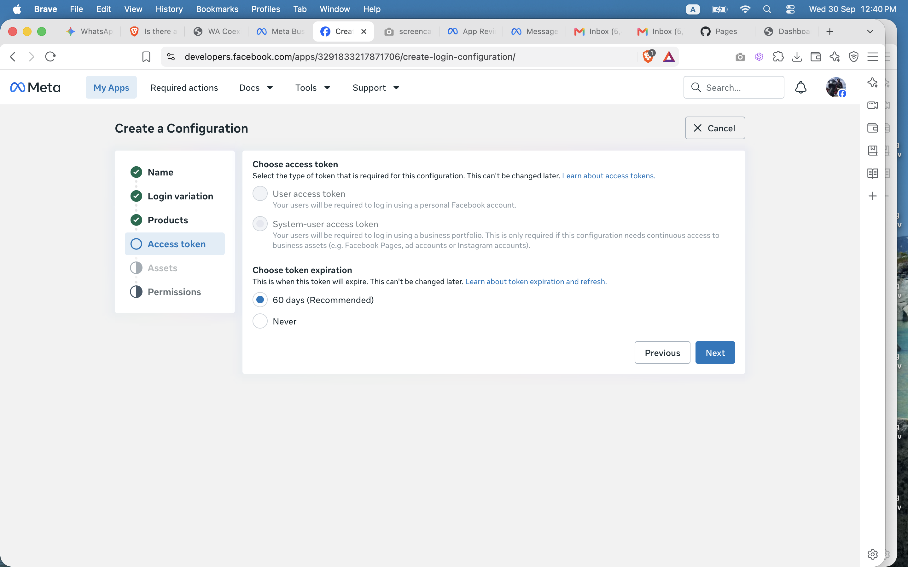
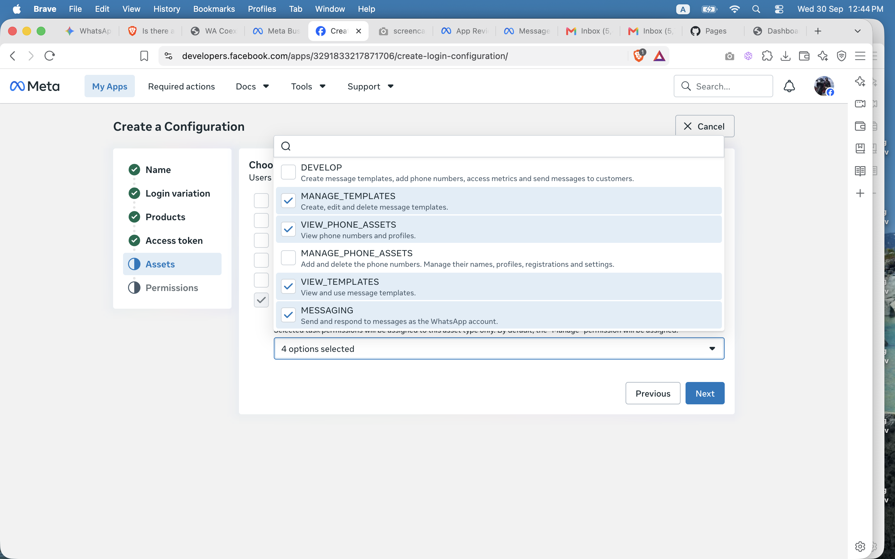
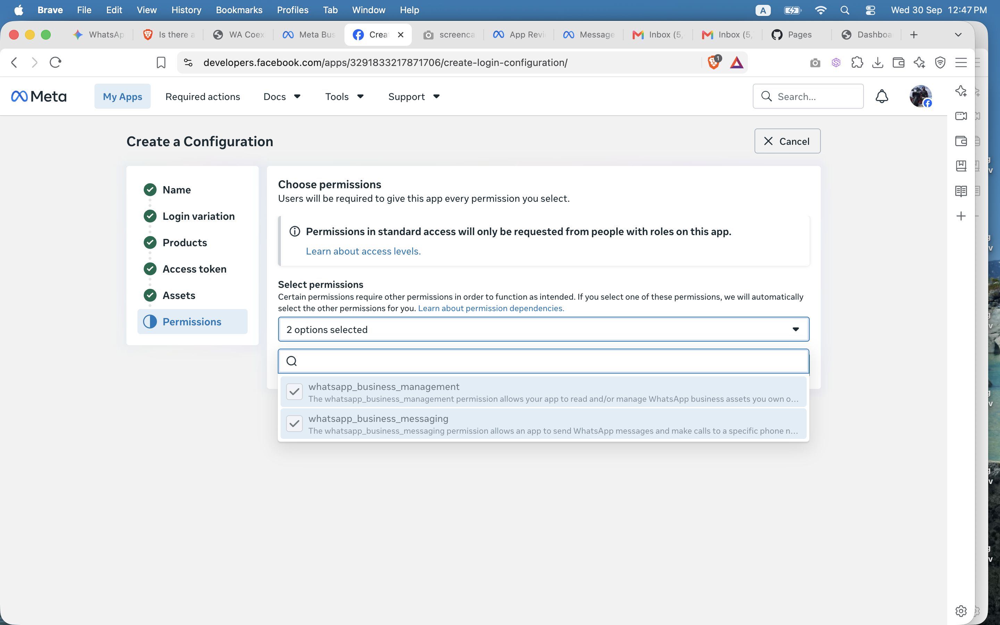
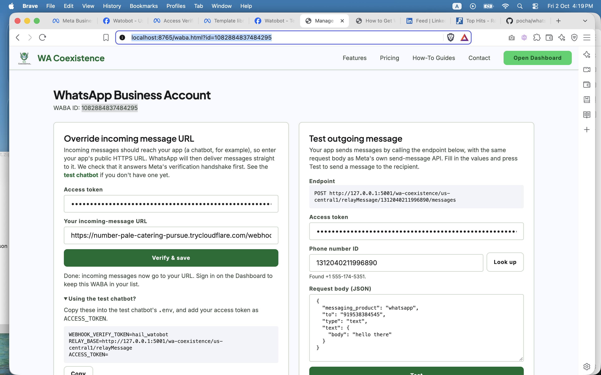
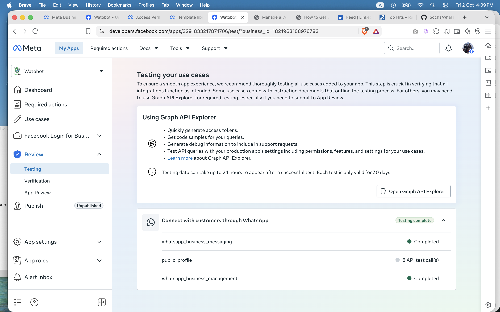
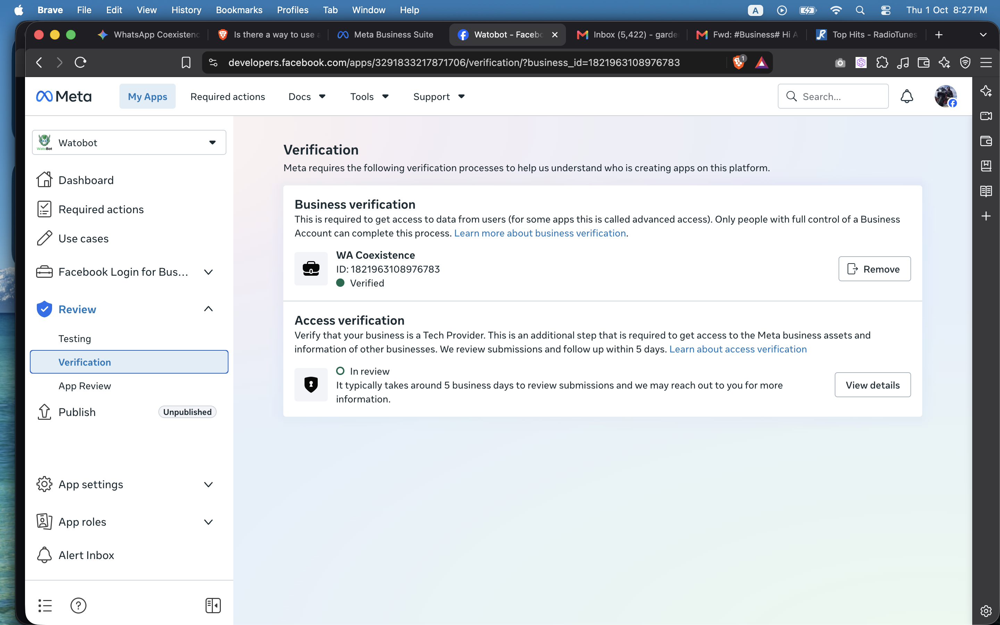

# WhatsApp Coexistence

Lets a business run the WhatsApp Business app and the WhatsApp API on the same
number at once ("coexistence"). The frontend is static and deployed to GitHub Pages: pages are
generated from `views/` and the browser scripts are TypeScript in `src/`, both built
into `public/` (`npm run build:pages`; `npm run typecheck` checks the types). The backend (`functions/`) is
Firebase Functions, Firestore and Firebase Auth.

## API

<!-- docs:only
Everything Watobot does for a number is available three ways: in the dashboard, as a call that takes your Watobot API key as `Authorization: Bearer <key>`, and as a tool in the MCP server (below). This page lists what is supported, so you can check it before you start, and the number's page in the dashboard shows each call with its address filled in. Answers are JSON with `ok` (and `error` when `ok` is false), except sends and the template list, create, edit and delete, which return Meta's response unchanged.
-->

<!-- docs:omit -->
Everything is a Firebase HTTPS function under `https://us-central1-wa-coexistence.cloudfunctions.net`, and a function is an Express app that routes by the rest of the path. They are grouped by what they work on, each with the phone number ID in the path where there is a number:

| Function | Path | Timeout |
| --- | --- | --- |
| `numbers` | `/numbers`, `/numbers/<id>/...`: the number, and the relay | 60 s |
| `templates` | `/templates/<id>/...`: list, create, edit, delete | 60 s |
| `templatesBulk` | `/templatesBulk/<id>/...`: migrate and import, which go through many templates | 300 s |
| `onboarding` | `/onboarding/...`: the wizard | 60 s |

The sign-in (`sendOtp`, `verifyOtp`, `rotateKey`), `webhook`, `mcp` and `joinWaitlist` are separate functions. Answers are JSON with `ok` (and `error` when `ok` is false), except the relay and the template list, create, edit and delete, which return Meta's response unchanged.

Three kinds of credential:
- **Key**: the Watobot API key, as `Authorization: Bearer <key>`. It is checked against the account, then used to open the stored Meta token for that one request. (The wizard's three checks take it as `apiKey` in the body instead, since they may also come from a signed-in browser.)
- **Signed in**: a Firebase ID token, `Authorization: Bearer <id token>`. Used by the dashboard, for the two reads of a number.
- **None**: anyone, or Meta.
<!-- /docs:omit -->

### Numbers: `/numbers`

`<id>` is the phone number ID. Every call takes the key as the bearer token; the two reads also take a sign-in.

| Method and path | What it does | Body |
| --- | --- | --- |
| `GET /numbers` | The account's numbers: where each is in onboarding (`step`), whether it is on the Business app, the syncs, usage, the sending status and the display name. Never the stored token (`hasToken` only). | |
| `POST /numbers` | Sign-up: exchanges the Embedded Signup code for the Meta token, checks with Meta that the WABA and phone number really are the signing-up user's (and that no other Watobot account holds the number), stores the token encrypted under the key, and starts the wizard for the number. Signed in, with the key in the body. | `code`, `wabaId`, `phoneNumberId`, `apiKey`, `event` |
| `GET /numbers/<id>` | One number as above, plus its template-send limits, the stored sending status and `nextRefreshAt`. It answers from what is stored and never asks Meta, so it is safe to repeat. With `?refresh=true` (the key, not a sign-in) it asks Meta right now: the number's status and display name approval, quality rating, messaging limit tier, account review and ownership, the apps subscribed with their callback URL override, the token's scopes and expiry, and Meta's own `health_status` (returned as `meta`), and stores the sending status (below). Meta is asked at most once in ten minutes: a refresh before then is `429` with `Retry-After` and the stored data. Each part of `meta` is a separate read, and a part Meta refuses says why. Never the token. 404 for a number that is not the caller's. | |
| `GET /numbers/<id>/notifications` | What Meta has told us about the number, newest first, kept for a month: a ban or restriction, a display name decision, a messaging limit change, a template paused or reinstated, and what a refresh found different. `?limit=` (up to 50) and `?before=` (the `nextBefore` of the last page) page back through them. Never a message. | |
| `PUT /numbers/<id>/webhook` | Checks the URL answers Meta's handshake, subscribes to it, and records it. During onboarding it also moves the wizard on. With `noCallback` instead of a URL it subscribes with no override: incoming events go to Watobot's own webhook, which discards them, and a coexistence number's contacts and history sync is skipped (Meta allows it once, to a URL). | `overrideCallbackUrl` or `noCallback` |
| `PUT /numbers/<id>/display-name` | Asks Meta to review a new display name. Refused while an earlier change is still in review, so nobody resubmits while waiting. | `displayName` |
| `POST /numbers/<id>/register` | Registers an API-only number. Refused for a number on the WhatsApp Business app. Waits up to 45 s for Meta. | `pin` (6 digits) |
| `POST /numbers/<id>/deregister` | Takes an API-only number off the Cloud API. Refused for a number on the Business app (disconnect there). | |
| `POST /numbers/<id>/disconnect` | What leaving Watobot does on Meta's side: unsubscribes our app, and de-registers an API-only number if asked. | `deregister` (boolean) |
| `POST /numbers/<id>/messages` | Sends a message through Meta with the stored token. Template sends are rate limited: a refused one gets 429 with `Retry-After`, and every template send answers with `X-RateLimit-Remaining-<Minute|Hour|Day>` and `X-RateLimit-Reset-<...>` (epoch seconds). A blocked number gets 403 for template sends (below). | Meta's messages body |
| `GET /numbers/<id>/limits` | Where the number stands against its template-send limits, per minute, hour and day window: accepted, attempted, previous window's count, limit, remaining and when it resets. Free-form messages are not limited. | |

### Templates: `/templates`, `/templatesBulk`

| Method and path | What it does | Body |
| --- | --- | --- |
| `GET /templates/<id>` | Lists the account's templates (id, name, status, category, language, components). The response is what `/templatesBulk/<id>/import` takes. | |
| `POST /templates/<id>` | Creates a template. | Meta's template body |
| `POST /templates/<id>/<templateId>` | Edits a template. | Meta's template body |
| `DELETE /templates/<id>?name=<name>` | Deletes every template with that name. | |
| `POST /templatesBulk/<id>/migrate` | Copies approved templates from a previous Messaging account (Watobot must be a partner on it). Answers `outcome: "unreadable"` if we can't read it. | `{ sourceWabaId }` |
| `POST /templatesBulk/<id>/import` | Creates templates from an exported list, up to 100 at a time. | `{ templates }` |

### The wizard: `/onboarding`

| Method and path | Credential | What it does | Body |
| --- | --- | --- | --- |
| `POST /onboarding/callback-check` | Signed in or key | Does Meta's handshake against a callback URL, before there is a number. | `overrideCallbackUrl` (and `apiKey` for a key) |
| `POST /onboarding/test-events` | Signed in or key | Posts one test webhook of each kind to a URL, with fresh codes. One send per 30 seconds. | `overrideCallbackUrl` |
| `POST /onboarding/test-codes` | Signed in or key | Says which of the four typed codes match the last send. | `codes` |
| `PUT /onboarding/<id>/step` | Key | Moves the wizard between the steps the user chooses or confirms. | `step` |
| `POST /onboarding/<id>/sync` | Key | Requests the contacts, then the history sync (each once). | `syncType` |
| `POST /onboarding/<id>/sync/skip` | Key | Skips the contacts and history sync for good (Meta allows each once). Only at the sync step. | |

**Sending status.** What decides whether a send goes out is kept on the number as `health`: the issues that currently restrict it, grouped by what they are about (`account`, `business`, `display_name`, `phone`) and by what they are (`payment`, `ban`, `review`, `connection`, `restriction`, `quality`, `cooldown`, `name`, `business`, or `code_<N>` for a Meta error we have no wording for). An issue exists only while it applies; when it lifts it is deleted. It is set by:

- **Meta's notifications to our webhook** (below), applied as they arrive. An event sets or clears only its own issue: a lifted ban leaves a payment problem where it is, and an event older than what is stored for that issue is ignored.
- **A refresh** (`GET /numbers/<id>?refresh=true`, which is the dashboard's refresh button and an AI tool's `get_number` with `refresh`), at the end of onboarding, and a send Meta refuses. A refresh reads Meta's whole picture and replaces what the notifications had set, except anything that arrived while it ran. Meta is asked at most once in ten minutes.

Each issue says what it does to sending (`send`): `limit`, `block` or `disable`. A scope's status is the worst of its issues, and the number's is the worst of the scopes:

| Status | When | What the relay does |
| --- | --- | --- |
| `disable` | The account is banned or scheduled to be disabled, deleted, rejected in review, or the number is disconnected | Refuses every send with `403`, free-form messages too |
| `block` | Meta says the account or number is blocked (for example a payment method problem), a restriction on business-initiated messaging, or Meta's spam rate limit (a pause of an hour) | Template messages get `403`, or `429` with `Retry-After` when the block has an end time. Free-form replies still go through. |
| `limit` | The number itself is limited (a display name not approved yet), flagged or of low quality, or the business is unverified | The issue's ceiling applies: at most 5 template messages a day for a limited number (our own cautious figure), or Meta's cap. |
| `ok` | No issue | Normal limits. |

An issue may carry a `cap` per window; the lowest of these and Meta's daily messaging limit (250 while the business is unverified) is `health.limits`, which caps what the number has earned (see Rate limits). Each issue has a `title`, a `message` that says what is wrong and what to do, and where we know one a `link`, written for the cases we know and in Meta's words for any other. A refused send returns the blocking `issues`. The number's page shows one chip per scope (OK, Limited or Blocked) and the popup lists the issues. Any other account-level field Meta sends is kept as a notification that gates nothing. The wording for every signal is one table, `functions/src/helpers/rules.ts`.

<!-- docs:omit -->
### The account and the rest

| Method and path | Credential | What it does | Body |
| --- | --- | --- | --- |
| `POST /sendOtp` | None | Sends a sign-in code on WhatsApp. | `phone` |
| `POST /verifyOtp` | None | Checks the code and signs in (or resets a lost key). | `phone`, `code`, `apiKey?`, `resetApiKey?` |
| `POST /rotateKey` | Signed in | Replaces the API key and re-encrypts every stored token. | `oldApiKey`, `newApiKey` |
| `POST /joinWaitlist` | None | Counts a waitlist click. | |
| `POST /mcp` | Key (bearer, or `/mcp/<key>`) | The hosted MCP server (see below). | MCP messages |

### Meta calls this one

| Method and path | What it does |
| --- | --- |
| `GET /webhook` | Answers Meta's verification handshake. |
| `POST /webhook` | Receives the webhooks that can't be overridden. Checks Meta's `X-Hub-Signature-256` (an HMAC of the body with the app secret) and refuses anything else with 401. The account-level ones (`account_update`, `account_review_update`, `account_alerts`, `phone_number_name_update`, `phone_number_quality_update`, `business_capability_update`, `security`, and the template status and quality updates) are matched to the number by WABA ID, stored as its notifications under a stable id (so a retry is stored once), and applied to its sending status. Anything else about the account is kept as a notification, whether or not we act on it. What customers wrote or did (messages, echoes, syncs, calls, flows, user preferences, group events) is never read or kept. |

The request bodies are typed in `functions/src/helpers/types.ts`, and each function's routes are listed at the top of `numbersApi.ts`, `onboardingApi.ts` and `wabaManager.ts` (templates).
<!-- /docs:omit -->

<!-- docs:only
### What Watobot does not do

- It does not keep your messages, contacts or chat history. Incoming messages, and the one-time contacts and history sync, go straight from WhatsApp to your callback URL. Outgoing messages are counted, never stored.
- It does not do Meta's sign-up for you: the Facebook login and the code or QR in the WhatsApp Business app are always done by you, in the browser.
- It does not queue messages yet: a send over a limit is refused (429) and can be retried.
-->

## MCP server

An AI tool can use the calls above through MCP: check a callback URL, send test events, get the link for Meta's sign-up, read a number's state, sync, register, send messages, manage templates, de-register and disconnect. `deregister_number`, `disconnect_number` and `delete_template` are marked destructive. The tools are one piece of code, [`functions/src/mcp/tools.ts`](functions/src/mcp/tools.ts), offered two ways:

| | Hosted | Local |
| --- | --- | --- |
| For | claude.ai, ChatGPT, and Claude Code or Cursor over http | Claude Code, Claude Desktop, Cursor and others that launch a program |
| Where it runs | our servers: `POST /mcp` | on the user's computer: the `watobot-mcp` package in [`mcp/`](mcp/), over stdio |
| The key | `Authorization: Bearer <key>`, or in the address (`/mcp/<key>`) for tools that only take an address | the `WATOBOT_API_KEY` environment variable |
| Setup | the dashboard's **API key** page builds the address and commands from the key you paste | `claude mcp add watobot -e WATOBOT_API_KEY=<key> -- npx -y watobot-mcp` |

There is no OAuth: the Watobot API key is the credential, as everywhere else. The hosted server is stateless (each request is a new server, nothing about the caller is kept), checks the key against the account before answering anything (401 otherwise), and never logs it. A new user signs up on the site and creates the key there (it is made in the browser and shown once, so no tool can make it). Meta's sign-up (Facebook login, the code or QR in the WhatsApp Business app) is always done by the person: the `start_onboarding_link` tool gives a link that opens the dashboard wizard at that step, with the checks already done, and after the sign-up the wizard tells them to go back to their AI tool, which reads the result with `get_number`.

<!-- docs:omit -->
Develop it with `cd functions && npm run test:unit` (the tools) and `cd mcp && npm test` (the local package builds, starts and lists its tools).
<!-- /docs:omit -->

## Roadmap

What is built and what is next is in [roadmap.md](roadmap.md), with the Meta behaviours we rely on and the open questions.

## Setup

### 1. Business Portfolio

Create one by following steps 1 to 3 of the guide:
[How to Create a Meta Business Portfolio & Add Your WhatsApp Number](https://watobot.com/how-to/create-meta-business-portfolio-add-whatsapp-number.html).

Stop after step 3. Skip steps 4 and 5 (adding a WhatsApp account and an app):
that guide is written for people who are their own provider. Here, the portfolio
only needs to exist so the Meta app can be attached to it in step 2. Do not add
your phone number to this portfolio. Customers' numbers, including your test
number, are connected through Embedded Signup, which creates their WABA under
their own portfolio. Pre-attaching the number to a WABA, or registering it on
the Cloud API, would make Meta treat it as an existing API number and push you
into migration instead of coexistence.

### 2. Meta app

Create the app by following
[How to Get WhatsApp API for Free](https://watobot.com/how-to/get-whatsapp-api-for-free.html)
(the app-creation steps; you don't need its access token section).

Then collect three values:

- **App ID** and **App Secret**: in the app, go to **App settings → Basic**.
  Put the App ID in `src/assets/app-config.ts` as `META_APP_ID` and the
  App Secret in `functions/.env` (step 3).
- **Embedded Signup Configuration ID**, created as follows. Configurations live
  under **Facebook Login for Business → Configurations**.

  1. Click **Create configuration**.

     

  2. **Name**: anything. **Login variation**: **WhatsApp Embedded Signup**.
  3. **Products**: check only **WhatsApp Cloud API**.

     

  4. **Access token**: **System-user access token**, with expiration **Never**.
     Meta says Tech Providers should use business (system-user) tokens, which
     belong to the customer's business, not to the person who ran the popup,
     and don't depend on that person staying in the business. The token can't
     be changed after the Configuration is created.

     

  5. **Assets**: **WhatsApp accounts**, with the task permission **MANAGE**.

     

  6. **Permissions**: `whatsapp_business_management` and
     `whatsapp_business_messaging`.

     

  7. Save, and put the **Configuration ID** in `src/assets/app-config.ts` as
     `META_CONFIG_ID`.

### Permissions

Under **Other tools → Permissions and features**, the app only needs
`whatsapp_business_management` and `whatsapp_business_messaging`. Don't add
anything else. `business_management`, `email`, `manage_app_solution` and
`whatsapp_business_manage_events` aren't used. `public_profile` is granted
automatically.

.permissions.png)

The app's own webhook, and the verifications Meta requires, come after the
backend is deployed (step 4).

### How customer tokens are handled

Meta requires a Tech Provider to protect, and not share, customers' access tokens, so
we hold each customer's token and never hand it out.

- Each account has a **Watobot API key**: 32 random bytes, generated in the
  browser and shown once, when the account first onboards a number. We store only a
  hash of it, on the user record. The browser doesn't keep it: the user types it
  whenever it is needed. Whenever a key is created or replaced, the user is signed
  out, so they have to type it to sign in again and see how much it matters.
- The key derives (HKDF-SHA256, with separate labels) both that hash and an
  AES-256-GCM key. The second one encrypts each number's Meta token, on
  `phoneNumbers/{phoneNumberId}`. The hash can't decrypt anything, and there is no server
  secret, so the stored data is unreadable without the customer's key.
- A request that carries the key (a send through the relay, setting the
  incoming URL, managing templates) lets the backend decrypt the token in memory,
  use it, and drop it.
- **Rotating** the key needs the old one. The `rotateKey` function re-encrypts every
  token under the new key in one batch, so the plaintext token is only ever in server
  memory, never in the browser. A **lost key can't be recovered**: resetting it (from the
  sign-in screen, the dashboard or the onboarding page) warns that the onboarded WABAs
  will be useless, deletes the stored tokens, and gives a new key. Each number must
  then be onboarded again.
- **Users manage their own account from the browser** (`src/assets/account.ts`):
  creating and resetting the key, and deleting the account. Functions are for what needs
  the Meta App Secret or a plaintext token: onboarding, key rotation, the relay, setting
  the incoming URL, templates, and the sign-in reset.

Data model. Functions create these records; a signed-in user can then read and manage
only their own, within the limits in `firestore.rules` (they can never change `userId`,
`usage` or `lastRelayCall`):

| Document | Fields |
|---|---|
| `users/{randomUserId}` | `phoneNumber`, `apiKeyHash`, `createdAt`, `rotatedAt` |
| `phoneIndex/{phone}` | `userId` |
| `phoneNumbers/{phoneNumberId}` | `userId`, `wabaId`, `phoneNumberId`, `displayPhoneNumber`, `encAccessToken`, `overrideUrl`, `activatedAt`, `lastRelayCall`, `usage`, `rateState`, `limits` |

The Firebase sign-in `uid` is the random user ID, not the phone number.

### Rate limits

Template messages sent through the relay are rate limited per number, to protect the number
from being flagged. Free-form replies are not limited.

- **The values** are in [`functions/src/helpers/rateLimiter.ts`](functions/src/helpers/rateLimiter.ts):
  per window (minute, hour, day) a `floor` that is always allowed and a `growthPercent` over the
  previous window, plus statistical headroom. A send over any window's limit gets a `429` with
  `Retry-After`.
- **Per-number limits:** `limits` on that number's `phoneNumbers/{id}` record is what it has earned per
  window, `{ "minute": 10, "hour": 50, "day": 100 }` at the start. To start an account that is moving
  over in good standing higher, write bigger values with the Admin SDK or the Firebase console
  (customers can't write it), for example `{ "minute": 100, "hour": 500, "day": 2000 }`. They apply at once
  and then only grow. The limit in force is the lower of these and the ceilings from the number's health
  (Meta's daily messaging limit, and a few a day while it is limited).
- **State** is `rateState` on the same record: per window the accepted count and the attempted
  count (refused requests included), for the current and the previous window. The limit is worked
  out from the *accepted* previous count only, so refused requests can't raise it. The number's page
  in the dashboard shows both, with the limits that apply. The limiter itself is
  [`rateLimiter.ts`](functions/src/helpers/rateLimiter.ts), shared by the Functions and the page.

### 3. Local setup

Prerequisites: Node 24 and the Firebase CLI (`npm i -g firebase-tools`).

```bash
npm install
cd functions && npm install && cp .env.example .env
```

Fill in `functions/.env`:

```
META_APP_ID=<your App ID>
META_APP_SECRET=<your App Secret>
WEBHOOK_VERIFY_TOKEN=<any string you make up>
WATOBOT_API_KEY=<your watobot API key>
```

`WATOBOT_API_KEY` is used to send the login OTP over WhatsApp through
[watobot](https://github.com/pocha/mudbot). `.env` is gitignored, so don't
commit it. `WEBHOOK_VERIFY_TOKEN` must also equal the `WEBHOOK_VERIFY_TOKEN` in
`src/assets/app-config.ts`, which the WABA page shows to people setting up the
test chatbot.

Run the tests, from `functions/`:

```bash
npm test                  # unit tests, then emulator-backed integration tests
npm run test:unit         # fast, no emulator
npm run test:integration  # real Firestore/Auth/Functions emulators
```

The MCP server has its own tests: `cd mcp && npm test` (it builds first).

Run the app, from the repo root:

```bash
npm start
```

This builds the pages, serves them at `http://localhost:8765/dashboard/`, and
starts the Functions, Firestore and Auth emulators. Use `localhost`, not
`127.0.0.1`, because Meta's domain checks treat them as different domains.
`Ctrl+C` stops everything. Emulator UI: `http://127.0.0.1:4000`.

Things to know:

- Firestore and Auth are emulated, so local sign-ins are emulator-only users.
- `sendOtp` sends a real WhatsApp message through watobot, even locally.
- Embedded Signup talks to Facebook's real servers, so real values in
  `functions/.env` and `app-config.js` are needed to try it.
- In your Meta app, add `localhost` to **App Domains** and to **Allowed
  Domains for the JavaScript SDK**.

Check the app locally by signing in at `http://localhost:8765/dashboard/` with
a number you own, entering the WhatsApp OTP you receive.

**Try the MCP server locally.** With `npm start` running, sign in at `http://localhost:8765/dashboard/` and
create an API key on the **API key** page (the emulator database starts empty, so a key from the live site
doesn't exist here). There are two servers to try, and neither needs anything but `npm start`.

*Hosted* (the `mcp` Function): it is served by the same emulator, at
`http://127.0.0.1:5001/wa-coexistence/us-central1/mcp`. The key goes in the `Authorization: Bearer <key>` header
or at the end of the address (`…/mcp/<key>`).

- **MCP Inspector** (a web page with a button per tool, no AI involved; the best first try):
  `npx @modelcontextprotocol/inspector`, then choose **Streamable HTTP**, enter the address and add the header.
- **Claude Code**: `claude mcp add --transport http watobot http://127.0.0.1:5001/wa-coexistence/us-central1/mcp --header "Authorization: Bearer <key>"`
- **claude.ai or ChatGPT** can't reach your computer, so give them a tunnel to the emulator:
  `npx cloudflared tunnel --url http://127.0.0.1:5001`, then add a custom connector (no authentication) with
  `https://<the tunnel>/wa-coexistence/us-central1/mcp/<key>`. The onboarding link it gives you opens
  `http://localhost:8765`, which is right when the browser is on the same computer.

*Local* (the npm package, launched by the tool):

```bash
cd mcp && npm install && npm run build      # makes mcp/dist/index.js; rebuild after changes
```

Three environment variables point it at your local setup (without them it talks to production):

| Variable | Value for local |
|---|---|
| `WATOBOT_API_KEY` | the key you just created |
| `WATOBOT_API_URL` | `http://127.0.0.1:5001/wa-coexistence/us-central1` |
| `WATOBOT_SITE_URL` | `http://localhost:8765` (the onboarding link then opens your local wizard) |

- **MCP Inspector**: `WATOBOT_API_KEY=<key> WATOBOT_API_URL=… WATOBOT_SITE_URL=… npx @modelcontextprotocol/inspector node $PWD/mcp/dist/index.js`
- **Claude Desktop**: add this to `~/Library/Application Support/Claude/claude_desktop_config.json`
  (Windows: `%APPDATA%\Claude\claude_desktop_config.json`), then quit and reopen it:

  ```json
  { "mcpServers": { "watobot": {
      "command": "node",
      "args": ["<full path to>/mcp/dist/index.js"],
      "env": { "WATOBOT_API_KEY": "<key>", "WATOBOT_API_URL": "http://127.0.0.1:5001/wa-coexistence/us-central1", "WATOBOT_SITE_URL": "http://localhost:8765" }
  } } }
  ```
- **Claude Code**: `claude mcp add watobot -e WATOBOT_API_KEY=<key> -e WATOBOT_API_URL=… -e WATOBOT_SITE_URL=… -- node <full path to>/mcp/dist/index.js`

A test onboarding then goes: the tool checks your callback URL and sends test events (the
[test chatbot](test-chatbot/README.md) is a callback URL you can use), gives you the link, and you do
Meta's sign-up in the browser (Facebook login, then the code or QR in the WhatsApp Business app). The
emulated functions call the real Meta API, so `functions/.env` needs real `META_APP_ID` and
`META_APP_SECRET`, and your callback URL must be reachable from the internet. Afterwards ask the tool for
the number's state: it reports the step (`sync` or `register`, then `done`). The key sits in the tool's
config file (or, for a connector, in its address) in plain text, so don't use a production key where it could be shared or screen-recorded.

**Waitlist.** The dashboard (`/dashboard/` and its pages) is open to anyone, so Meta's reviewers can
sign in and test the app. The landing page's **Join Waitlist** button reveals the Google Group link,
and a count of people who clicked it is kept in `meta/waitlist`, incremented by the `joinWaitlist`
function once per browser. The nav button on the landing page still says **Join Waitlist**; point it
at `/dashboard/` (in `views/partials/header.html`) when you want the site itself to lead there.

### 4. Production deployment

**Frontend (GitHub Pages).** In the repo, go to **Settings → Pages → Source:
GitHub Actions**. Every push to `main` that touches `public/`, `views/`, `src/` or
`scripts/build-pages.js` runs `.github/workflows/deploy-pages.yml`, which type-checks,
builds the pages and scripts, and publishes `public/`. The generated HTML and JS are
not committed. Set a
custom domain in the same Pages settings if you want one. The site's links
assume it is served from the root of its domain.

**Backend (Firebase).**

1. Create a Firebase project and upgrade it to the Blaze plan (Functions need
   it to make outbound calls). Enable **Firestore**. Custom-token sign-in needs
   no provider toggle.
2. Point the repo at your project: set the project id in `.firebaserc`, and the
   web config and Functions URL in `src/assets/firebase-init.ts`.
3. Make sure `functions/.env` is filled in. `firebase deploy` packages the file
   as it sits on disk.
4. Deploy:

   ```bash
   firebase login
   firebase deploy --only firestore          # rules and indexes
   cd functions && npm run deploy            # builds, then deploys all the Functions
   ```

   Redeploy the Functions whenever one changes: the dashboard and the MCP server call them by name, so a
   page or an MCP release that uses a new route (for example `GET /numbers`) needs the
   Functions deployed first. `META_APP_SECRET` must be in `functions/.env`: it is how `webhook` checks that
   a request was signed by Meta, and anything else gets a 401.
5. Read what the Functions did in Cloud Logging (or `firebase functions:log`). Each failed request, each
   failed Meta call and each state change (number connected, registered, synced, disconnected) is a
   structured entry: filter by `jsonPayload.fn="numbers"`, `jsonPayload.phoneNumberId="…"` or
   `severity>=ERROR`. Keys, tokens, OTP codes and message bodies are never logged.

**Expire the notifications (once per project).** A number's notifications are kept for a month. Each one carries
an `expireAt`, and a Firestore TTL policy on that field does the deleting:

```bash
gcloud firestore fields ttls update expireAt --collection-group=notifications --enable-ttl --project <project-id>
```

Deleting the TTL policy keeps them forever, and the emulator doesn't run it. (Deleting an account removes them at
once.)

**MCP server, hosted.** It is the `mcp` Function, deployed with the others. Its address is
`https://us-central1-wa-coexistence.cloudfunctions.net/mcp`. Because the connector address carries the user's
API key, keep that function's requests out of Cloud Logging, which records the full address of every request.
Add an exclusion once per project (check the filter in the console's Logs Explorer first):

```bash
gcloud logging sinks update _Default --project <project-id> \
  --add-exclusion='name=mcp-requests,filter=resource.type="cloud_run_revision" AND resource.labels.service_name="mcp" AND log_id("run.googleapis.com/requests")'
```

The function's own logs never contain the key. If an address does leak, replace the key on the **API key** page.

**MCP server (npm).** Publish `mcp/` as `watobot-mcp` so people can run it with `npx`. Deploy the Functions
first, then, from `mcp/`:

```bash
npm login                      # once; the package name must be free on npm
npm version patch              # or minor/major
npm publish                    # runs the build first (prepublishOnly)
```

Users add it with `claude mcp add watobot -e WATOBOT_API_KEY=<key> -- npx -y watobot-mcp` (the same line is on
the dashboard's **API key** page). It talks to production unless `WATOBOT_API_URL` is set. For the
[MCP registry](https://registry.modelcontextprotocol.io) and the directories that crawl npm, the
`keywords` in `mcp/package.json` already include `mcp` and `mcp-server`.

**Let `verifyOtp` sign login tokens (once per project).** Login mints a Firebase
custom token, which the function must sign. In production it signs as its own
service account, and that account needs permission to do so. Without it, sign-in
fails with `Permission 'iam.serviceAccounts.signBlob' denied`. Find the account
the function runs as, then grant it the **Service Account Token Creator** role on
itself:

```bash
SA=$(gcloud run services describe verifyotp --region us-central1 \
  --project <project-id> --format="value(spec.template.spec.serviceAccountName)")

gcloud iam service-accounts add-iam-policy-binding "$SA" \
  --member="serviceAccount:$SA" \
  --role="roles/iam.serviceAccountTokenCreator" \
  --project <project-id>
```

This is the project's default compute service account
(`<project-number>-compute@developer.gserviceaccount.com`), and the role is
granted on that account only, not on the whole project. The IAM Service Account
Credentials API (`iamcredentials.googleapis.com`) must be enabled, which it
normally is. The change can take a minute or two to apply. It isn't needed
locally, where the Auth emulator doesn't check signatures.

**The app's webhook (after the deploy).** When `firebase deploy` finishes it
prints the URL of each function, including a line like
`Function URL (webhook(us-central1)): https://...`. That is your webhook URL.
Meta requires the app itself to have a webhook before a business's
incoming-URL override can be set. Without one, **Verify & save** on a WABA's
page fails with "your app must be subscribed to receive messages for WhatsApp
Business Account".

1. In the app dashboard, go to **Use cases → Customize → Step 2. Production
   setup → Configure Webhooks** and set:
   - **Callback URL**: the `webhook` function URL from the deploy output.
   - **Verify token**: the same value as `WEBHOOK_VERIFY_TOKEN` in
     `functions/.env` (and in `src/assets/app-config.ts`).

   Click **Verify and save**. Meta calls the function to check the token, so
   it must already be deployed.

   .dashboard-webhook-setup.png)

2. Under **Webhook fields**, subscribe to exactly these, and switch the rest
   off:

   | Field | Why |
   |---|---|
   | `messages` | Incoming messages and delivery statuses. |
   | `smb_message_echoes` | Messages typed in the Business app, so a bot doesn't reply on top of a human. |
   | `smb_app_state_sync` | Contact and state sync for coexistence. |
   | `history` | Chat history sync for coexistence. |
   | `account_update` | Bans, restrictions, disconnections and the other account events that decide whether a number may send. |
   | `account_review_update` | The account's policy review. |
   | `account_alerts` | Limit increases denied, extra verification needed. |
   | `phone_number_name_update` | A display name approved or declined. |
   | `phone_number_quality_update` | A number's messaging limit or quality changing. |
   | `business_capability_update` | The business's messaging limit tier (it changes when the business is verified). |
   | `security` | Changes to a number's security settings. |
   | `message_template_status_update` | Tells a business when a template is approved, rejected, paused or disabled. |
   | `message_template_quality_update` | A template's quality changing. |
   | `business_status_update`, `account_settings_update` | Not documented in Meta's webhook reference yet. Like any other account-level field, they are kept as notifications as they arrive, and gate nothing, so we can see what they say. |

   Those from `account_update` down arrive at our own webhook only: they can't be sent to a customer's URL. See
   the number's **Notifications** on the dashboard for what they look like.

.dashboard-webhook-fields.png)

   (That screenshot shows Meta's default selection, which is longer than the
   list above.)

### Testing and verification

Meta requires the following before the app can act as a Tech Provider.

**Review → Testing.** Meta wants an API call made with each permission your use
case lists. Do both from the page of the test number that came with your app. It
needs an incoming-message URL; if you don't have an app, use the
[test chatbot](test-chatbot/README.md) for one.

Everything is done with your **Watobot API key**. You never handle a Meta access token: Embedded Signup
gives Watobot the token, which it stores encrypted under your key and opens only for the request you make.

1. Sign in at `https://watobot.com/dashboard/` (or `http://localhost:8765/dashboard/` locally, see step 3)
   and create your API key on the **API key** page. Copy it: it is shown once.
2. **Onboard a number**: click **Onboard WABA** and follow the wizard (or let an AI tool do the checks through
   the MCP server, which hands you a link for Meta's sign-up). The number comes out of Meta's sign-up with its
   own phone number ID, shown on its page in the dashboard (`/dashboard/waba/?id=<phone number ID>`).
3. **Override incoming message URL**: in the wizard (or on the number's page), enter your Watobot API key and
   your app's public HTTPS URL, then click **Verify & save**. This completes the test for
   `whatsapp_business_management`.
4. **Send a message**: copy the curl command on the number's page, put in your key and a recipient number,
   and run it in a terminal:

   ```bash
   curl -X POST https://us-central1-wa-coexistence.cloudfunctions.net/numbers/<phone number ID>/messages \
     -H "Authorization: Bearer <your Watobot API key>" -H "Content-Type: application/json" \
     -d '{"messaging_product":"whatsapp","to":"<recipient, digits only>","type":"text","text":{"body":"Hello from Watobot"}}'
   ```

   This completes the test for `whatsapp_business_messaging`. A free-form text reaches only people who wrote to
   the number in the last 24 hours; otherwise send a template message (see
   [Rate limits](#rate-limits)).

To check the result without the dashboard, `GET /numbers/<phone number ID>/limits` with the same bearer key
shows the number's send limits, and the MCP server's `get_number` and `get_limits` tools show the state.



Meta says the results can take up to 24 hours to appear, and each test stays
valid for 30 days. `public_profile` needs no specific count. When everything is
done, the page looks like this:



**Review → Verification.** Meta requires two verifications:

- **Business verification** of the portfolio the app is attached to. Complete
  it with the same name, address and phone number you entered when creating the
  portfolio, matched to the document you upload. See Meta's
  [Verify Your Business](https://www.facebook.com/business/help/2058515294227817)
  guide.
- **Access verification**, which confirms your business is a Tech Provider. See
  Meta's [Become a Tech Provider](https://developers.facebook.com/documentation/business-messaging/whatsapp/solution-providers/get-started-for-tech-providers)
  guide. Review typically takes around 5 business days. While it is pending,
  Embedded Signup fails with "App not active".



Embedded Signup does not work until the app has Advanced Access to
`whatsapp_business_management` and `whatsapp_business_messaging`, which comes
from App Review. Being an admin of the app does not get around it: the popup
fails with "Partner app lacks required advanced WhatsApp Business management
and messaging permissions for onboarding" (error `#2655111`). Until then you can
test everything except onboarding: the incoming-URL override and sending work
on any WABA you hold a token for, such as the test account that came with your
app (see "Review → Testing" above).
